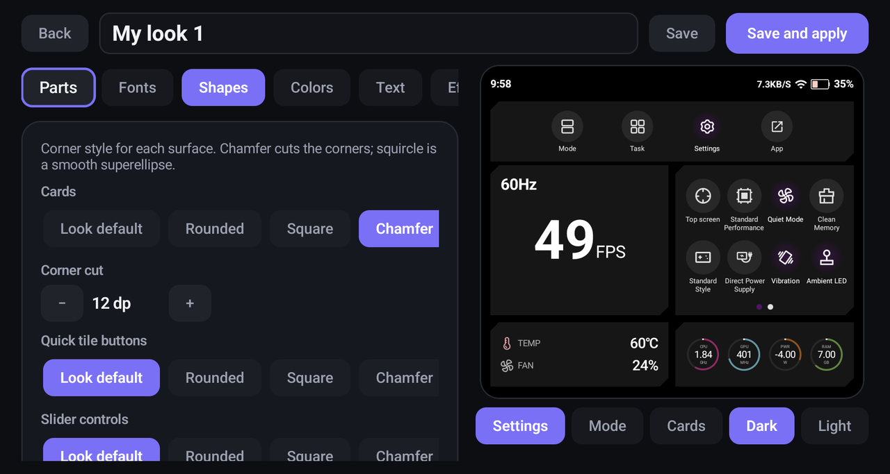
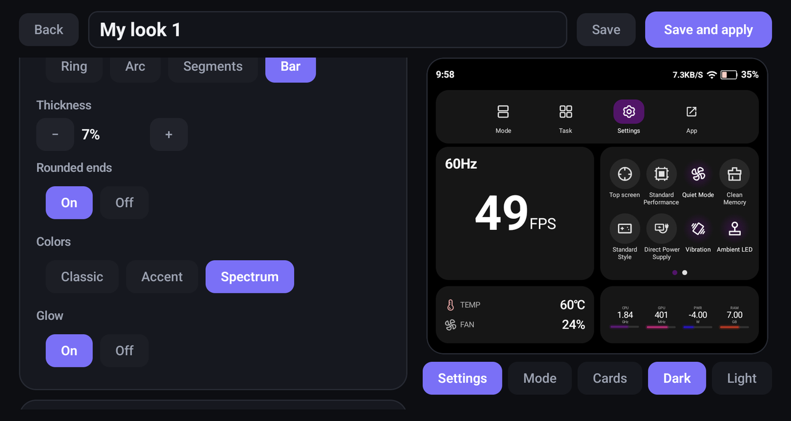
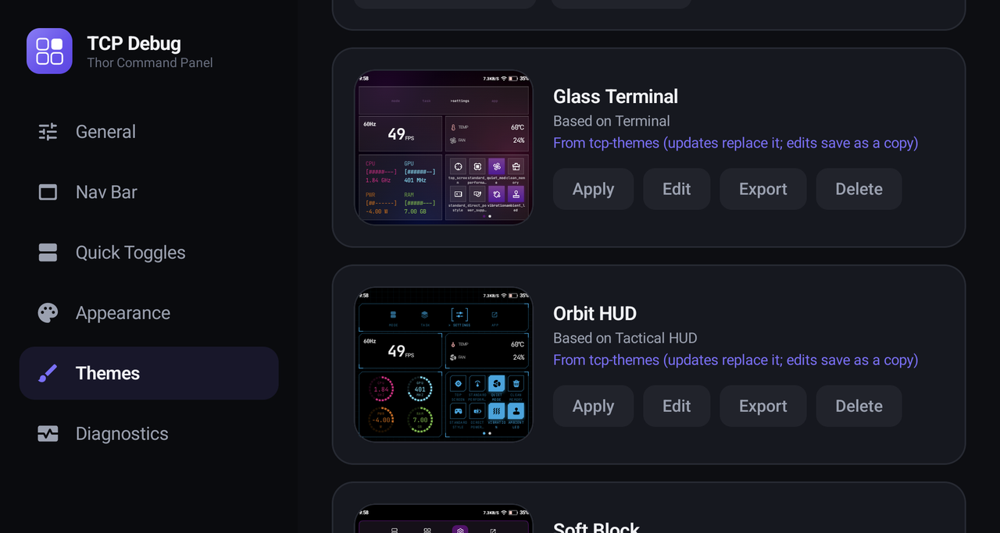

<div align="center">
  
  <h1>Command Panel</h1>
  <p><b>A user-installable replacement for the AYN Thor's stock dual-screen assistant.</b></p>
  <p>The bottom-screen control panel, rebuilt as a normal app you can install yourself. It handles the essentials (screen modes, brightness, volume, quick toggles, and live hardware telemetry), then goes well past the original with themes, a <b>Theme Studio</b> for building your own, a companion app, and more.</p>
</div>

---

## Inspiration

Command Panel stands on the shoulders of two projects:

- **AYN's stock Dual-Screen Assistant** (`com.odin.dualscreen.assistant`) — the built-in app this replaces. Command Panel rebuilds its layout, behavior and hardware integration so it feels native on the Thor.
- **[Better Dual Screen Assistant](https://github.com/stormpanda) by stormpanda** — the source-available project that first showed how a normal app can stand in for the system assistant on this hardware. It was studied as **prior art and inspiration** — patterns to learn from, not code to copy. Everything shipped here is either my own work or re-derived from AYN's stock app. See [Upstream & licensing](#upstream--licensing) at the bottom.

---

## Looks

Command Panel ships **16 overlay themes** (plus the stock look) — the whole panel re-skins live, fonts and all. Three favorites:

| Aurora Glass | Tactical HUD | Stock |
|:---:|:---:|:---:|
|  |  |  |

**[→ Browse all 17 looks](assets/looks/)** &nbsp;·&nbsp; or see the [gallery image](assets/looks-gallery.png) (Cartridge, Segment LCD, Terminal, Cockpit, Comic Panel, Neon Arcade, Bloom, Jelly, Y2K Chrome, E-Ink, Industrial, Sticker Book, Soft Console, …).

> 🎨 **Want to add your own theme?** A single Look re-skins both the overlay and the companion. See the **[Theming Guide wiki](https://github.com/BrianJr03/command-panel/wiki)** — it walks through adding one (even with an AI agent) and the gotchas to watch for.
>
> 🧩 **Prefer no code?** Build your own in the **[Theme Studio](#theme-studio)** right on the device.

---

## Theme Studio

**Design your own overlay look on the device. No code, no rebuild.** The companion's **Themes** section has a full-screen editor with a live preview of the real overlay pinned beside it. Every change shows up immediately, and **Save and apply** restyles the overlay on the spot.

| Build it | Custom parts | Share and follow |
|:---:|:---:|:---:|
|  |  |  |

- **Mix and match.** Start from any of the 17 looks and swap any part from the others: Terminal's ASCII gauges on Aurora Glass cards, Cockpit dials with Jelly tiles, whatever you like. Cards, tiles, gauges, sliders, nav, backdrop and card headers are all interchangeable.
- **Build from scratch.** Every part has a **Custom** style you design yourself:
  - Fill (surface, tonal, accent, glass, gradient), opacity, border, hard shadow and glow.
  - Gauges as rings, arcs, segments or bars, with classic, accent or spectrum colors.
  - Nav highlights as a pill, underline, block or dot.
- **Shapes, colors and type:**
  - Corner style per surface: rounded, square, chamfer, squircle or pill.
  - Pinned accent, second accent, background and card colors, or follow the system theme. Text stays readable automatically.
  - Label case and letter spacing.
  - Effects: glow, scanlines, motion, backdrops.
- **Your own fonts.** Use any of the bundled fonts, or import your own TTF/OTF files.
- **Preview every size.** Switch the preview between the Settings and Mode tabs and a **Cards** view that shows each card in its other layouts (2×2 rings, ring strip, two-column TEMP/FAN, small FPS), in dark and light.
- **Share as packs.**
  - Export one look or all of them as a `.tcplooks.json` pack into `/sdcard/TCP Themes/`.
  - The fonts your looks use are copied into `/sdcard/TCP Themes/fonts/`, and a pack can list official download links (for example Google Fonts) so others can fetch fonts they don't have.
  - Packs dropped into that folder show up with previews, ready to add or use as a starting point.
- **Follow theme repos.**
  - Paste a GitHub link and its looks are added; they update when the author pushes changes.
  - Start your own from the **[tcp-themes template](https://github.com/BrianJr03/tcp-themes)**: press *Use this template*, export your looks into `themes/`, push, and share the link.
  - The pack format is documented in the template's README.
- **Gamepad-first**, like the rest of the companion.

---

## Features

### Everything the stock assistant does
- **Bottom-screen overlay** answering the AYN hardware button, as a persistent service.
- **Screen modes** — dual screen, top-only, bottom-only (with real screen blanking).
- **Brightness & volume** for each screen.
- **60/120 Hz toggle** with a live FPS readout.
- **Quick-setting tiles** — focus lock, performance mode, fan control, clean memory, controller style, direct power, vibration, ambient LED, force landscape, theme.
- **Hardware telemetry** — temperature, fan, and CPU / GPU / power / RAM gauges.
- **Task** (recent apps) and **Settings** dialogs.

### What I added on top
> The reason to run this instead of the stock app.

- 🖌️ **[Theme Studio](#theme-studio)** — mix parts from any look or build one from scratch (Custom parts, shapes, colors, your own fonts) with a live preview; share looks as packs or follow GitHub theme repos for updates.
- 🎨 **16 overlay themes** — Aurora Glass, Tactical HUD, Terminal, Segment LCD, Comic Panel, Cockpit, Neon Arcade, Bloom, Jelly, Y2K Chrome, E-Ink, and more. Each restyles cards, tiles, gauges, sliders and fonts.
- 📱 **Companion settings app** — a modern, fully **gamepad-navigable** console for configuring everything.
- 🧩 **Customizable quick toggles** — enable/disable tiles and **drag-and-drop to reorder** them.
- ✋ **Arrange mode** — long-press the overlay to drag-and-drop its cards into any layout.
- ⏺️ **Replay Buffer** — a rolling screen-capture buffer you can dump to an MP4 clip after the moment.
- 💡 **Ambient-LED → accent sync** — the overlay accent follows the Thor's stick LED color.
- 🚀 **Quick Launch** — a one-tap app launcher button in the nav bar.
- 🔋 **Battery time estimate** and an option to **hide the network-speed** readout.
- 💾 **Settings backup & restore.**
- 🎮 **Full gamepad navigation** across the whole UI.
- 🧷 **Quality-of-life:** the overlay reopens on your last tab, a pinned top nav bar, and a launcher icon of its own.

---

## Requirements

- An **AYN Thor** (the dual-screen Android handheld this targets).
- The **stock Dual-Screen Assistant** present on the device — Command Panel loads AYN's icons from it at runtime rather than bundling copies (see below).
- Root is obtained through the Thor's own `PServerBinder`, the same mechanism the stock app uses — no custom firmware or unlock needed.

Command Panel installs side-by-side (`.debug` builds carry a `-debug` suffix). A **Replace Stock Assistant** toggle decides whether Command Panel or the built-in app answers the hardware button.

> ⚠️ Personal, non-commercial project for my own device. No warranty — use at your own risk.

---

## Build

```sh
./gradlew :app:assembleDebug        # build the debug APK
./gradlew :app:installDebug         # install on a connected Thor
./gradlew :app:testDebugUnitTest    # unit tests
```

Signed release builds are produced by CI (`.github/workflows/build-release.yml`) from a keystore in repo secrets; release notes come from `app/src/main/res/raw/patch_notes.md`.

---

## Contributing

**Sharing looks doesn't need a PR.** Build them in the [Theme Studio](#theme-studio), publish them in a repo made from the [tcp-themes template](https://github.com/BrianJr03/tcp-themes), and share the link.

To add a **built-in** Look to the app itself, contribute a **new theme (Look)** — one Look re-skins both the overlay and the companion. The **[Theming Guide wiki](https://github.com/BrianJr03/command-panel/wiki)** is a full walkthrough (including a ready-to-use AI-agent prompt): the anatomy of a Look, a remix-existing-styles path vs. a new-renderer path, the screenshot workflow, and the gotchas (palette/contrast, font clipping, OFL-fonts-only, runtime stock icons). Please include before/after screenshots of both overlay tabs in your PR. Only contribute fonts/art/code you have the right to ship.

---

## Upstream & licensing

Command Panel was **inspired by** stormpanda's Better Dual Screen Assistant (a source-available, personal-use project), and care was taken to respect that license. At a high level:

- **No upstream code is shipped.** BDSA was read as prior art; every technical fact was re-derived from AYN's own stock app. The app contains no stormpanda code.
- **Only my own work was ported.** Features I wrote in my personal BDSA fork are mine to reuse; the few places that sat on upstream base code were **rewritten clean-room**, and the staging area that once held that work was **purged from this repo's git history**.
- **No AYN art is redistributed.** The stock icons are loaded **at runtime** from the Thor's installed stock app — the repo and APK bundle **zero** AYN drawables.
- **Fonts** are SIL OFL 1.1, shipped with their notices.

The full, auditable record lives in **[`docs/reference/LICENSE_COMPLIANCE.md`](docs/reference/LICENSE_COMPLIANCE.md)**.
