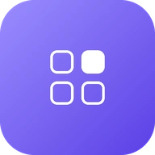
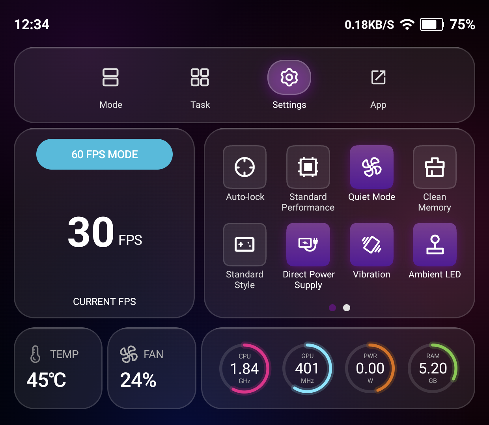
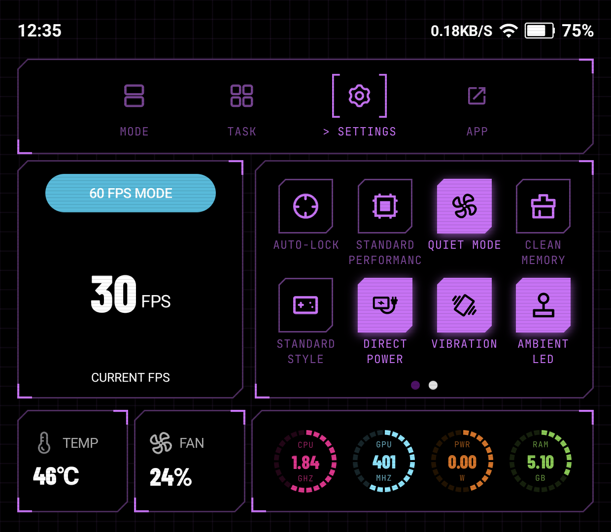
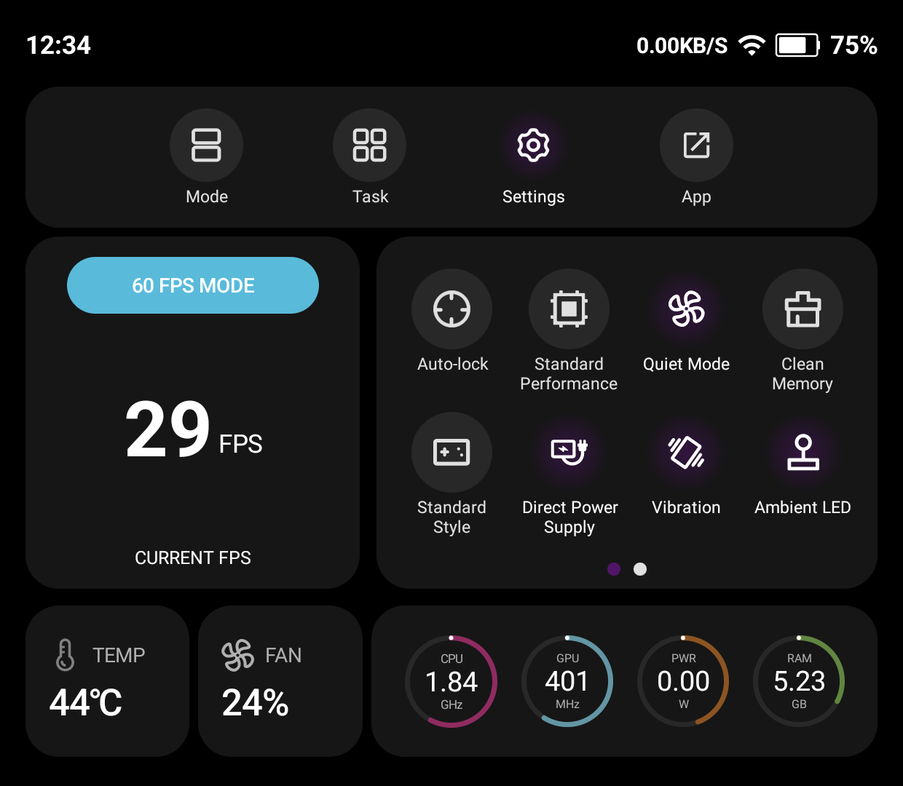

<div align="center">
  
  <h1>Command Panel</h1>
  <p><b>A user-installable replacement for the AYN Thor's stock dual-screen assistant.</b></p>
  <p>The bottom-screen control panel — screen modes, brightness, volume, quick toggles and live hardware telemetry — rebuilt as a normal app you can install yourself, then pushed well past the original with themes, a companion app, and more.</p>
</div>

---

## Inspiration

Command Panel stands on the shoulders of two projects:

- **AYN's stock Dual-Screen Assistant** (`com.odin.dualscreen.assistant`) — the built-in app this replaces. Command Panel rebuilds its layout, behavior and hardware integration so it feels native on the Thor.
- **[Better Dual Screen Assistant](https://github.com/stormpanda) by stormpanda** — the source-available project that first showed how a normal app can stand in for the system assistant on this hardware. It was studied as **prior art and inspiration** — patterns to learn from, not code to copy. Everything shipped here is either my own work or re-derived from AYN's stock app. See [Upstream & licensing](#upstream--licensing) at the bottom.

---

## Looks

Command Panel ships **16 overlay themes** (plus the stock look) — the whole panel re-skins live, fonts and all. Three favorites:

| Aurora Glass | Tactical HUD | Stock |
|:---:|:---:|:---:|
|  |  |  |

**[→ Browse all 17 looks](assets/looks/)** &nbsp;·&nbsp; or see the [gallery image](assets/looks-gallery.png) (Cartridge, Segment LCD, Terminal, Cockpit, Comic Panel, Neon Arcade, Bloom, Jelly, Y2K Chrome, E-Ink, Industrial, Sticker Book, Soft Console, …).

> 🎨 **Want to add your own theme?** A single Look re-skins both the overlay and the companion. See **[GUIDELINE.md](GUIDELINE.md)** — it walks through adding one (even with an AI agent) and the gotchas to watch for.
>
> 🧩 **No code needed:** the companion's **Themes** section has a **Theme Studio**. Mix parts from any Look, or build one from scratch with Custom parts, shapes, colors and fonts. Looks are shared as `.tcplooks.json` packs through `/sdcard/TCP Themes/` or a GitHub theme repo made from **[theme-template/](theme-template/)**.

---

## Features

### Everything the stock assistant does
- **Bottom-screen overlay** answering the AYN hardware button, as a persistent service.
- **Screen modes** — dual screen, top-only, bottom-only (with real screen blanking).
- **Brightness & volume** for each screen.
- **60/120 Hz toggle** with a live FPS readout.
- **Quick-setting tiles** — focus lock, performance mode, fan control, clean memory, controller style, direct power, vibration, ambient LED, force landscape, theme.
- **Hardware telemetry** — temperature, fan, and CPU / GPU / power / RAM gauges.
- **Task** (recent apps) and **Settings** dialogs.

### What I added on top
> The reason to run this instead of the stock app.

- 🎨 **16 overlay themes** — Aurora Glass, Tactical HUD, Terminal, Segment LCD, Comic Panel, Cockpit, Neon Arcade, Bloom, Jelly, Y2K Chrome, E-Ink, and more. Each restyles cards, tiles, gauges, sliders and fonts.
- 📱 **Companion settings app** — a modern, fully **gamepad-navigable** console for configuring everything.
- 🧩 **Customizable quick toggles** — enable/disable tiles and **drag-and-drop to reorder** them.
- ✋ **Arrange mode** — long-press the overlay to drag-and-drop its cards into any layout.
- ⏺️ **Replay Buffer** — a rolling screen-capture buffer you can dump to an MP4 clip after the moment.
- 💡 **Ambient-LED → accent sync** — the overlay accent follows the Thor's stick LED color.
- 🚀 **Quick Launch** — a one-tap app launcher button in the nav bar.
- 🔋 **Battery time estimate** and an option to **hide the network-speed** readout.
- 💾 **Settings backup & restore.**
- 🎮 **Full gamepad navigation** across the whole UI.
- 🧷 **Quality-of-life:** the overlay reopens on your last tab, a pinned top nav bar, and a launcher icon of its own.

---

## Requirements

- An **AYN Thor** (the dual-screen Android handheld this targets).
- The **stock Dual-Screen Assistant** present on the device — Command Panel loads AYN's icons from it at runtime rather than bundling copies (see below).
- Root is obtained through the Thor's own `PServerBinder`, the same mechanism the stock app uses — no custom firmware or unlock needed.

Command Panel installs side-by-side (`.debug` builds carry a `-debug` suffix). A **Replace Stock Assistant** toggle decides whether Command Panel or the built-in app answers the hardware button.

> ⚠️ Personal, non-commercial project for my own device. No warranty — use at your own risk.

---

## Build

```sh
./gradlew :app:assembleDebug        # build the debug APK
./gradlew :app:installDebug         # install on a connected Thor
./gradlew :app:testDebugUnitTest    # unit tests
```

Signed release builds are produced by CI (`.github/workflows/build-release.yml`) from a keystore in repo secrets; release notes come from `app/src/main/res/raw/patch_notes.md`.

---

## Contributing

The easiest way to contribute is a **new theme (Look)** — one Look re-skins both the overlay and the companion. **[GUIDELINE.md](GUIDELINE.md)** is a full walkthrough (including a ready-to-use AI-agent prompt): the anatomy of a Look, a remix-existing-styles path vs. a new-renderer path, the screenshot workflow, and the gotchas (palette/contrast, font clipping, OFL-fonts-only, runtime stock icons). Please include before/after screenshots of both overlay tabs in your PR. Only contribute fonts/art/code you have the right to ship.

---

## Upstream & licensing

Command Panel was **inspired by** stormpanda's Better Dual Screen Assistant (a source-available, personal-use project), and care was taken to respect that license. At a high level:

- **No upstream code is shipped.** BDSA was read as prior art; every technical fact was re-derived from AYN's own stock app. The app contains no stormpanda code.
- **Only my own work was ported.** Features I wrote in my personal BDSA fork are mine to reuse; the few places that sat on upstream base code were **rewritten clean-room**, and the staging area that once held that work was **purged from this repo's git history**.
- **No AYN art is redistributed.** The stock icons are loaded **at runtime** from the Thor's installed stock app — the repo and APK bundle **zero** AYN drawables.
- **Fonts** are SIL OFL 1.1, shipped with their notices.

The full, auditable record lives in **[`docs/reference/LICENSE_COMPLIANCE.md`](docs/reference/LICENSE_COMPLIANCE.md)**.
